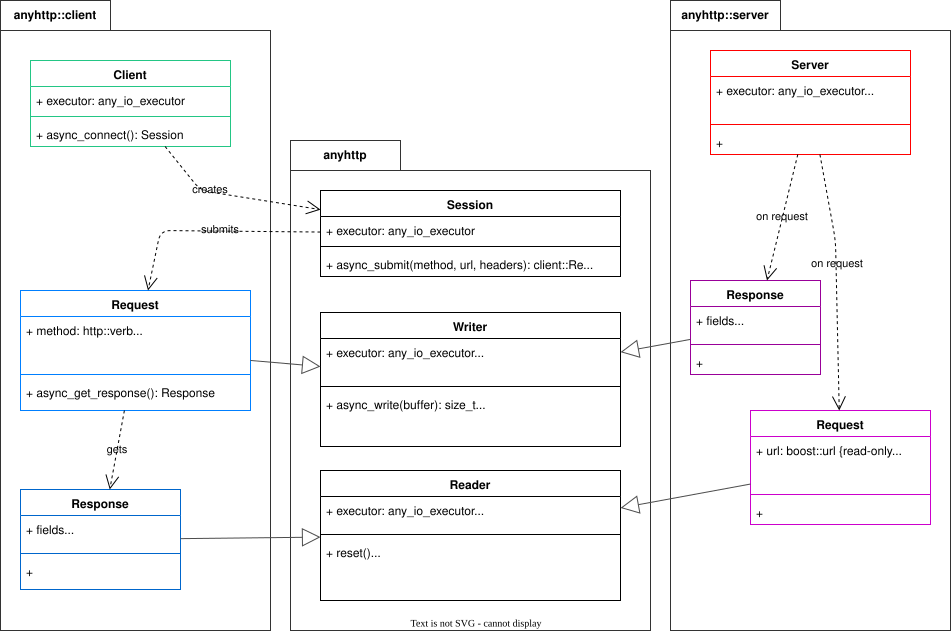

.. cpp:namespace:: anyhttp

How it is put together
======================

What a program sees is a handful of move-only handles, each a pointer to an implementation that the
protocol backend provides: that is the type erasure. So a :cpp:class:`server::Request` and a
:cpp:class:`client::Response` are a :cpp:class:`Reader`, a :cpp:class:`server::Response` and a
:cpp:class:`client::Request` are a :cpp:class:`Writer`, and all of them have no data members but that
pointer. Moving one into a ``Reader`` or ``Writer`` hands off that half with its ownership intact.

Layers
------

Each protocol lives in a directory of its own, in both ``include/anyhttp/`` and ``src/``. Only these
may include the header of the protocol library that goes with them, which is what keeps nghttp2,
ngtcp2 and nghttp3 from being compile-time dependencies of anyone who uses anyhttp:

.. list-table::
   :header-rows: 1

   * - Directory
     - Protocol
     - On top of
   * - ``h1/``
     - HTTP/1.1
     - Beast's parser and serializer
   * - ``h2/``
     - HTTP/2
     - nghttp2
   * - ``h2v2/``
     - HTTP/2, an alternative to ``h2/``, see :doc:`http2-library`
     - nghttp2 version 2
   * - ``quic/``
     - QUIC transport, and plain QUIC streams
     - ngtcp2
   * - ``h3/``
     - HTTP/3
     - nghttp3, and ``quic/``
   * - ``asio/``, ``corosio/``
     - the runtime, see :doc:`api-styles`
     - Asio, or Corosio and Capy

Generic code (``server_impl.*``, ``client_impl.*``) reaches a backend only through
``h1/backend.hpp``, ``h2/backend.hpp``, ``quic/backend.hpp`` and ``h3/backend.hpp``, and the runtime
only through ``anyhttp/runtime.hpp`` and ``anyhttp/net.hpp``.

QUIC and HTTP/3 are two layers, and each shares one implementation between server and client.
``quic/session.*`` has all ngtcp2 callbacks, packet writing, timers and connection flow control, and
``quic/stream.*`` what every stream has. What runs on a connection is a ``QuicApplication``, picked by
ALPN: HTTP/3 is one (``h3/application.*``), and plain QUIC streams are the other
(``quic/streams.*``). That no HTTP is in the transport is something the build can verify, see
:src:`CLAUDE.md`.

What gets installed is the public headers, the ones reachable from ``client.hpp``, ``server.hpp``,
``quic.hpp``, ``session.hpp`` and the like: :src:`cmake/install.cmake` leaves out the protocol
directories, ``net.hpp`` and ``*_impl.hpp``.

History
-------

This project started as a hand-written replacement for `nghttp2-asio
<https://github.com/nghttp2/nghttp2-asio>`__. Once the concept was working, HTTP/1.1 was added, and
both protocols were hidden behind a type-erased interface. Finally, HTTP/3 was added with the help of
agentic coding.
